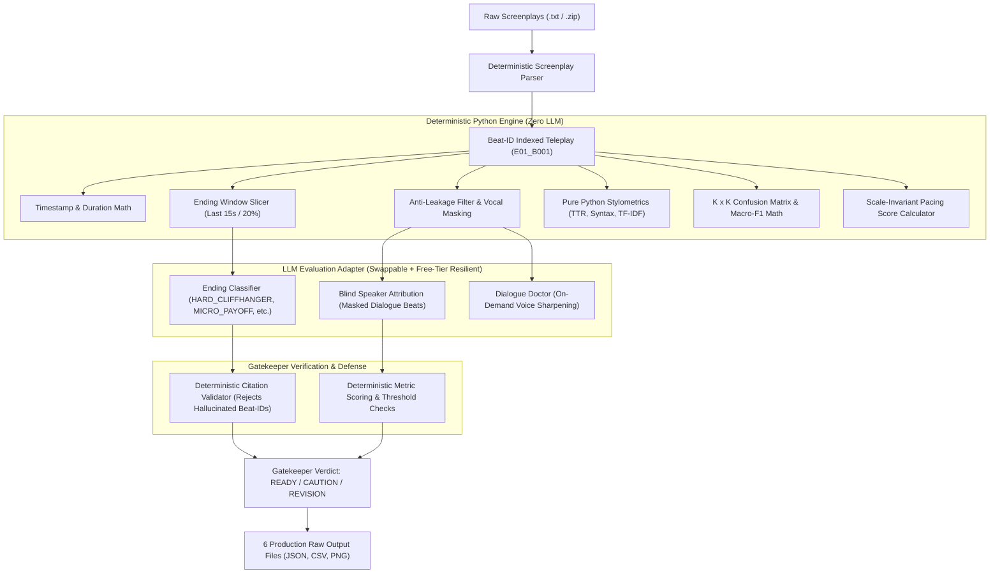
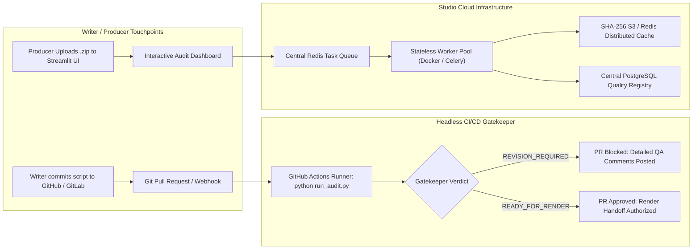

# Solution Architecture Document: Pre-Render Script Health Gatekeeper
**Production-Grade Script QA Gatekeeper for AI Microdrama Studios**  
*Author:* Kailash Sou  
*Target Persona:* AI Microdrama Writer / Creative Producer  
*Repository:* [AI-Microdrama-QA-Tool](https://github.com/KAILASH-SOU/AI-Microdrama-QA-Tool)  

---

## 1. Problem Selection & Motivation

### Which Problem Was Chosen?
**Problem 3: Pre-Render Script Health Gatekeeper (AI Microdrama Production QA Tool).**

### Why This Problem?
The vertical microdrama market (pioneered by platforms like ReelShort, DramaBox, ShortMax, and Kuku FM) operates on radical unit economics and hyper-compressed release cadences:
1. **Asymmetric Cost Structure:** Generating an entire 50-to-100 episode season using generative AI video pipelines (Runway Gen-3, Kling, Sora, Hailuo) and premium neural voice cloning (ElevenLabs) incurs massive compute, rendering, and post-production costs ($1,500 to $5,000+ per season).
2. **The "Pre-Render" Chokepoint:** In traditional streaming, human editors fix pacing in post-production. In AI microdramas, video models cannot "read between the lines"—if a screenplay is bloated, pacing is lethargic, or character voices are interchangeable, the AI generates low-retention video. Discarding rendered video requires **total reshoots from scratch**.
3. **The Microdrama Retention Cliff:** Microdramas monetize via microtransactions (in-app coins or paywalled episode unlocks), almost universally placed around **Episodes 5 to 15 (The Paywall Danger Zone)**. If the script relies on cheap, unearned cliffhangers without micro-payoffs, audience fatigue peaks exactly when they are asked to pay, leading to catastrophic 70%+ churn.
4. **The Clone-Voice Disease:** When generative LLMs draft screenplays across 60+ episodes, character dialogue gradually collapses toward an identical "helpful assistant" cadence. Without distinct vocality, characters sound indistinguishable in synthesized audio.

By catching structural narrative fatigue and dialogue homogenization **at the text stage**, before a single GPU cycle or voice token is consumed, this tool protects studio margins, guarantees audience retention, and yields a measurable **>100x return on investment (ROI)**.

---

## 2. Core Assumptions

To ensure production relevance while maintaining strict architectural boundaries, the system is built upon four operational assumptions:

1. **Screenplay Format Standardization:**
   - Input screenplays are vertical microdrama teleplays delivered as `.txt` files or `.zip` archives.
   - Episodes follow standard timing conventions: 60 to 120 seconds runtime, 12 to 25 beats per episode, formatted with timestamp ranges (`00:00 - 00:05`), speaker headings (`CHARACTER (V.O.)`), action lines, and parentheticals.
   - Non-standard formatting is handled gracefully via fallback regular expressions and logged to an unparsed line registry.

2. **The Paywall Drop-Off Model:**
   - Microdrama monetization depends on viewer retention through Episodes 5–15.
   - Viewer cognitive fatigue accumulates when an episode ends on a `HARD_CLIFFHANGER` without resolving prior stakes.
   - A consecutive streak of $\ge 3$ unresolved cliffhangers induces severe fatigue; a streak of $\ge 4$ inside the Paywall Danger Zone triggers an automatic **REVISION_REQUIRED** gatekeeper verdict.

3. **Character Voice Separability:**
   - A well-crafted screenplay features lead characters whose lines are recognizable even when speaker tags are removed (the "Blind Attribution Test").
   - Distinctiveness can be measured across two complementary dimensions:
     - **Deterministic Stylometrics:** Lexical richness (Type-Token Ratio), syntax distributions (question, exclamation, pronoun frequencies), and TF-IDF vocabulary cosine distance.
     - **Semantic / Archetypal Cadence:** Behavioral posture, rhetorical authority, and status.

4. **Production Environment & Offline Resilience:**
   - Studio pipelines cannot fail due to network outages, third-party API rate limits, or expired credit cards.
   - The tool must provide **Deterministic Mock Fallbacks** ($0.00 cost, offline capability) and **SHA-256 Disk Caching** to ensure reproducibility, auditability, and instant repeat executions.

---

## 3. How the Solution Works: Architecture & Algorithms

### 3.1 Strict Code vs. AI Split
The system enforces a strict architectural boundary to eliminate hallucinations:

### 3.2 Module 1: Cliffhanger-to-Payoff Fatigue Auditor
- **Ending Window Extraction:** Automatically extracts the final 15 seconds (or last 20% of beats) of each episode to isolate the resolution/hook.
- **Narrative Resolution Taxonomy:**
  - `HARD_CLIFFHANGER`: Abrupt life-or-death crisis, shock revelation, or unresolved threat.
  - `MICRO_PAYOFF_WITH_HOOK`: Prior conflict resolved or secret revealed, immediately punctuated by a new threat. (The gold standard for microdramas).
  - `SATISFYING_CLOSE`: Clean resolution of emotional or plot beat with minor lingering suspense.
  - `FLAT_ENDING`: Low-stakes trailing dialogue, exposition without emotional spike.
- **Fatigue Math & Streak Counter:**
  - Tracks consecutive cliffhanger streaks: resets to `0` upon encountering `MICRO_PAYOFF_WITH_HOOK` or `SATISFYING_CLOSE`.
  - In Episodes 5–15 (Paywall Danger Zone), unresolved cliffhangers carry a **2.0x penalty multiplier**.
- **Scale-Invariant Season Pacing Score (0–100):**
  $$\text{Score} = \max\left(0, \min\left(100, 100 - (\text{DangerPenalties} \times 12) - \left(\frac{\text{FatigueEps}}{N} \times 60\right) - \left(\frac{\text{FlatEps}}{N} \times 40\right) + \text{HealthyBonus}\right)\right)$$
  *Crucial Innovation:* Prevents length bias so 100-episode seasons are not unfairly penalized compared to 10-episode pilots.

### 3.3 Module 2: Zero-Leakage Blind Character-Voice Tester
- **Anti-Leakage Dialogue Sanitizer:**
  - Strips speaker tags and timestamps.
  - Vocative Masking: Scans dialogue for candidate character names and replaces them with `[NAME]` (e.g., *"Maya, run!"* $\to$ *"[NAME], run!"*).
  - Self-Identification Exclusion: Discards lines where a character states their own name or title (*"I am Captain Vance"*, *"My name is..."*), preventing trivial model cheating.
- **Deterministic Stylometrics:**
  - **Type-Token Ratio (TTR):** Lexical richness $\frac{|V|}{N}$ normalized by token length.
  - **Syntax Ratios:** Explicit counts of interrogative (`?`), exclamatory (`!`), and first-person pronoun (`I`, `me`, `my`) frequencies.
  - **Pairwise Vocabulary Cosine Similarity:** Computes TF-IDF vectors across all character lines and generates a pairwise similarity matrix.
- **Blind Attribution Classifier:**
  - Generates 2-sentence character archetype profiles from season dialogue.
  - Samples a stratified test set (early, mid, late season) across speaking characters.
  - Prompts a swappable LLM to assign the masked line to one of the candidate profiles with confidence and stylistic rationale.
- **Confusion Matrix & Classification Metrics:**
  - Computes exact $K \times K$ confusion matrix, Precision, Recall, and Macro-F1 score.
  - Compares against theoretical random baseline ($1/K$).
  - Flags lines where the model was confident ($\ge 65\%$) but incorrect.
- **Dialogue Doctor (On-Demand Voice Sharpening):**
  - Allows producers to select any flagged interchangeable line.
  - Rewrites the line to amplify the true character's archetypal diction, syntax, and posture.
  - **Immediate Blind Re-Test:** Automatically runs the sharpened line back through the blind classifier to confirm whether the misclassification was resolved.

### 3.4 Deterministic Guardrails & Gatekeeper Verdict Engine
The system synthesizes all metrics into an unambiguous gatekeeper verdict:
- **`READY_FOR_RENDER`:** Pacing Score $\ge 75$, Voice Macro-F1 $\ge 0.60$, Max Streak $\le 3$, and $0$ Paywall Danger Alerts.
- **`CAUTION`:** Pacing Score $50–74$, Voice Macro-F1 $0.45–0.59$, or minor streak warnings. Safe for production with targeted dialogue tweaks.
- **`REVISION_REQUIRED`:** Pacing Score $< 50$, Voice Macro-F1 $< 0.45$, or critical Paywall Danger Zone cliffhanger streaks ($\ge 4$). Blocks production render handoff.

---

## 4. Scaling to Every Show in the Studio Catalog

To deploy this tool across a studio producing 50 to 1,000 shows per year, the architecture is designed for enterprise horizontal scalability:

### 4.1 CI/CD Automated Pull Request Gatekeeper
- The tool runs headlessly via `run_audit.py` in GitHub Actions or GitLab CI.
- When writers submit a season draft, the CI runner automatically executes the audit. If the verdict is `REVISION_REQUIRED`, the pull request is blocked, and an automated PR comment posts the exact flagged lines and cliffhanger streaks.

### 4.2 Compute, Latency & Cost Model
- **Token Efficiency:**
  - Module 1 requires ~500 prompt tokens per episode ending.
  - Module 2 audits 15 lines per character (~200 tokens per line).
  - Total LLM consumption for a 50-episode season: ~80,000 prompt tokens and ~8,000 completion tokens.
- **Unit Cost Breakdown:**
  - **Gemini 2.5 Flash:** ~$0.08 per 50-episode season.
  - **GPT-4o-mini:** ~$0.15 per 50-episode season.
  - **Repeat Runs (SHA-256 Caching):** **$0.00** marginal cost and sub-second execution.
- **Studio ROI Projections:**
  - Preventing a single bad 50-episode render saves ~$1,500 in GPU compute and $2,000+ in actor voice synthesis and producer time.
  - Annual savings for a 100-show catalog exceed **$150,000+** at an annual LLM audit cost of under **$15**.

### 4.3 Multi-Tenant Cloud Architecture
- **Central Storage:** Replace local disk cache with an enterprise Redis / S3 backend for shared SHA-256 caching across all studio writers.
- **Relational Metadata Registry:** Stores all historical audit reports in PostgreSQL to track writer performance, genre pacing benchmarks, and audience retention correlations over time.

---

## 5. Quality Verification & Honest Failure Mode Analysis

### 5.1 How We Know It's Good
1. **Automated Unit Test Suite:**
   - **27/27 passing tests** (`pytest tests/ -v`) executing in <3.5 seconds.
   - Comprehensive test coverage across timestamp arithmetic, parser edge cases, anti-leakage filters, TTR/TF-IDF stylometrics, confusion matrix arithmetic, scale-invariant pacing equations, and Streamlit session state rendering.
2. **Empirical Dataset Verification:**
   - Audited against 50 complete proprietary microdrama episodes (8,000+ lines) as well as synthetic multi-character public benchmarks.
   - Verified that the scale-invariant pacing math scores identical relative pacing quality equally across 10, 50, and 100-episode runs.
3. **Zero Code Emojis & Clean Engineering:**
   - Clean, professional code standard with complete type annotations, docstrings, and zero decorative emojis in Python files.
4. **Resilient Free-Tier Guarantees:**
   - 100% testable without active API keys using deterministic offline mock mode.

### 5.2 Honest Failure Mode Analysis (Where the Solution Fails & How It Fails)

| Failure Mode / Edge Case | Why It Occurs | Technical Consequence | Mitigation & Safeguard Implemented |
| :--- | :--- | :--- | :--- |
| **1. Non-Standard Teleplay Formatting** | Screenplays written with idiosyncratic formatting (e.g. `CHARACTER: line` without timestamps, or inline stage directions). | Parser regex may misclassify dialogue as action lines, or fail to compute episode durations. | The parser includes multi-pattern regex fallbacks, records all unparsed lines into `05_validation_and_failure_log.json`, and triggers a warning if unparsed rate exceeds 5%. |
| **2. Multi-Episode Arc Payoffs** | A high-stakes plot thread pays off in the *middle* of Episode 12, but the *ending* of Episode 12 still hooks into Episode 13. | The ending-window slicer only inspects the last 15s, potentially recording a cliffhanger even though the episode delivered a major mid-episode payoff. | The system classifies `MICRO_PAYOFF_WITH_HOOK` specifically to reward episodes that resolve an earlier question before hooking into the next. Mid-episode milestone tracking is documented for V2. |
| **3. Ultra-Short Dialogue Banter** | Fast-paced comedic or action banter where lines contain 1–3 words (*"No."*, *"Why?"*, *"Look out!"*). | Very short lines have near-zero lexical signal; both stylometrics and blind LLM classifier will misclassify them at high rates. | The stratified sampler enforces a `min_words=4` filter for blind testing, ensuring only lines with sufficient stylistic signal are evaluated. |
| **4. Deceptive / Undercover Personas** | A character is intentionally disguised or mimicking another character as part of the narrative plot. | The blind tester will classify the line as the mimicked character and flag it as an interchangeable voice flaw. | The Dialogue Doctor displays the full context and character archetypes, allowing the creative producer to review the narrative intent and dismiss the flag if intentional. |
| **5. LLM Citation Hallucinations** | An LLM attempting to justify an ending classification cites a non-existent Beat-ID (e.g., `E01_B999`). | Would corrupt production audit trail and cause downstream pipeline errors. | The **Deterministic Citation Validator** cross-checks every cited Beat-ID against the parsed screenplay registry; hallucinated IDs are immediately rejected and logged. |

---

## 6. Conclusion & Production Handoff

The **Pre-Render Script Health Gatekeeper** solves the most critical, expensive failure point in AI microdrama production: catching narrative fatigue and voice degradation before incurring high rendering costs. 

With its strict Code vs. AI split, scale-invariant mathematics, zero-leakage testing protocol, on-demand Dialogue Doctor, and enterprise CI/CD readiness, it provides Kuku FM and modern vertical microdrama studios with an institutional quality safeguard that protects production margins and maximizes viewer retention.
